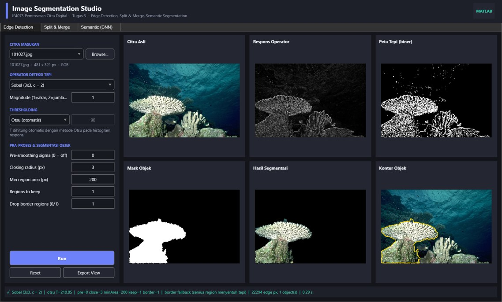

# Image Segmentation Studio

Program GUI MATLAB untuk Tugas 3 IF4073 Pemrosesan Citra Digital. Satu aplikasi
menyatukan tiga pendekatan segmentasi citra, masing-masing dalam satu tab:

| Tab | Bagian | Isi |
|---|---|---|
| **Edge Detection** | B | Segmentasi objek dari hasil deteksi tepi: Laplace, LoG, Sobel, Prewitt, Roberts (ditulis sendiri) dan Canny (bawaan MATLAB, memang diizinkan soal) |
| **Split & Merge** | C | Segmentasi klasik divide and conquer: quadtree split dengan predikat homogenitas `range` atau `std`, lalu merge region bertetangga yang gabungannya masih homogen |
| **Semantic (CNN)** | D | Segmentasi semantik dengan CNN yang di-fine-tune pada CamVid (11 kelas) |

Anggota kelompok:

| Nama | NIM |
|---|---|
| Nurul Na'im Natifah | 18223106 |
| Muhammad Izzat Jundy | 13523094 |



*Tangkapan layar tab Edge Detection setelah menjalankan Sobel pada `101027.jpg`.
Status bar di bawah menampilkan parameter efektif, jumlah piksel tepi, jumlah
objek, dan waktu proses.*

## Dependensi

| Kebutuhan | Versi | Catatan |
|---|---|---|
| MATLAB | R2019b atau lebih baru | memakai `uifigure`, `uigridlayout`, `uiaxes`; diuji pada R2026a |
| Image Processing Toolbox | wajib | `strel`, `imclose`, `imfill`, `bwareaopen`, `bwlabel`, `imdilate`, `imerode`, dan `edge` (khusus operator Canny) |
| Computer Vision Toolbox | opsional | hanya untuk caption pada gambar panel; tanpa toolbox ini gambar tetap jadi, teks judulnya saja yang kosong |
| Deep Learning Toolbox + Computer Vision Toolbox | hanya tab Semantic | memuat dan menjalankan model segmentasi semantik (bagian D) |
| Python | tidak perlu | seluruh program berjalan di MATLAB |

Operator deteksi tepi bagian B **tidak** memakai fungsi bawaan MATLAB:
konvolusi, Otsu, dan penelusuran zero-crossing ditulis sendiri di `src/core` dan
`src/b-edge-detection`. Toolbox hanya dipakai untuk morfologi (menutup celah
kontur, mengisi lubang, memberi label region).

## Cara Menjalankan

1. Clone repositori lalu masuk ke foldernya:
   ```bash
   git clone https://github.com/nafannn/image-segmentation.git
   cd image-segmentation
   ```
2. Buka MATLAB, lalu jalankan dari **root repo**:
   ```matlab
   addpath(genpath('src'))
   SegmentationApp
   ```
   Alternatif: `cd src` lalu `SegmentationApp` (aplikasi menambahkan foldernya
   sendiri ke path, tetapi `data/` dicari relatif terhadap root repo).
3. Jendela GUI terbuka dengan tiga tab. Di setiap tab:

   | Langkah | Keterangan |
   |---|---|
   | 1. Pilih citra | dropdown berisi 8 citra BSDS500 dari `data/bsds500/`, atau tombol **Browse...** untuk citra lain |
   | 2. Atur parameter | panel kiri; isinya menyesuaikan operator/predikat yang dipilih |
   | 3. **Run** | menjalankan pipeline; status bar menampilkan parameter efektif, jumlah objek/region, dan waktu proses |
   | 4. **Reset** | mengosongkan citra dan mengembalikan parameter ke nilai default |
   | 5. **Export View** | menyimpan seluruh tampilan jendela sebagai PNG |

4. Panel di sisi kanan menampilkan hasil bertahap:

   | Tab | Urutan panel |
   |---|---|
   | Edge Detection | citra asli, respons operator, peta tepi biner, mask objek, hasil segmentasi, kontur objek |
   | Split & Merge | citra asli, grid quadtree, rata-rata blok, rata-rata region, label region, batas region |
   | Semantic | citra masukan, label semantik, overlay, plus legenda kelas |

### Parameter yang sering disesuaikan

| Tab | Parameter | Arti |
|---|---|---|
| Edge Detection | `Otsu` / `Percentile` / `Manual` | cara memilih ambang peta tepi; Otsu otomatis dari histogram respons |
| | `Magnitude` (1/2/3) | varian kekuatan tepi: akar, jumlah absolut, atau maksimum |
| | `preSigma`, `closeRadius`, `minArea`, `keepN`, `clearBorder` | pra-pelebaran Gaussian, radius closing, luas region minimal, jumlah region yang dipertahankan, buang region yang menyentuh tepi |
| Split & Merge | `Tsplit` / `Tmerge` | threshold homogenitas saat split / saat merge (skala intensitas 0-255) |
| | `minBlock` / `minRegion` | ukuran blok terkecil (px) dan luas region minimal (px) |
| Semantic | - | model dan daftar kelas mengikuti model bagian D |

Nilai default sudah disetel untuk citra BSDS500 (481x321): bagian C memakai
`minBlock` 16 px, `minRegion` 1500 px, dan `Tsplit = Tmerge` 25 (predikat `std`)
atau 60 (predikat `range`), sehingga satu citra menghasilkan puluhan region,
bukan ribuan. Threshold tetap boleh disesuaikan per citra.

### Catatan saat menjalankan

- Tab **Semantic** menampilkan pesan peringatan (bukan crash) selama model bagian
  D belum tersedia; tab Edge Detection dan Split & Merge tetap dapat dipakai.
- Pada citra bertekstur sangat padat, semua region hasil pengisian kontur bisa
  menyentuh tepi citra. Program tidak mengembalikan mask kosong: filter
  `clearBorder` dilewati dan status bar menuliskan
  `border fallback (semua region menyentuh tepi)`.
- Kalau muncul `Undefined function 'SegmentationApp'`, path belum ditambahkan -
  ulangi langkah 2.

## Struktur Berkas

```
src/
  SegmentationApp.m        GUI utama (3 tab)
  core/                    utilitas bersama: konvolusi, Otsu, registri parameter,
                           label-to-RGB, serta pipeline applyEdgeSegmentation dan
                           applySplitMerge yang dipanggil GUI
  b-edge-detection/        bagian B: 6 operator tepi, zero-crossing, mask objek
  c-split-merge/           bagian C: quadtree split, region adjacency, merge
  d-semantic/              bagian D: segmentSemantic(img) untuk CNN
data/
  bsds500/                 8 citra uji bagian B dan C
  README.md                keterangan data dan pranala unduh CamVid
docs/
  gui_preview.jpg          tangkapan layar GUI untuk README
```

## Data Uji

- **BSDS500**: 8 citra pada `data/bsds500/`, dipakai untuk bagian B dan C.
- **CamVid** (bagian D): tidak disimpan di repositori karena ukurannya besar.
  Pranala unduh ada di [`data/README.md`](data/README.md); citra diletakkan di
  `data/camvid/`.

## Lisensi

[MIT License](LICENSE)
